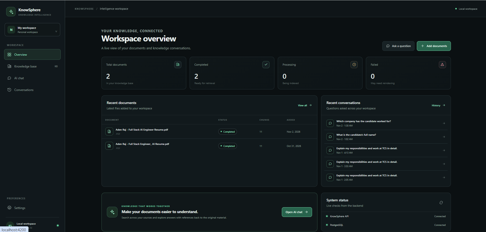
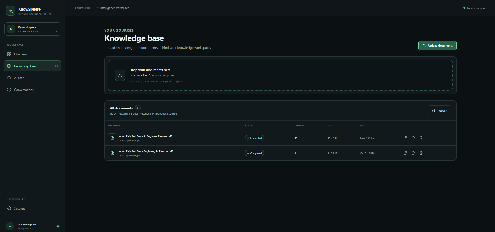
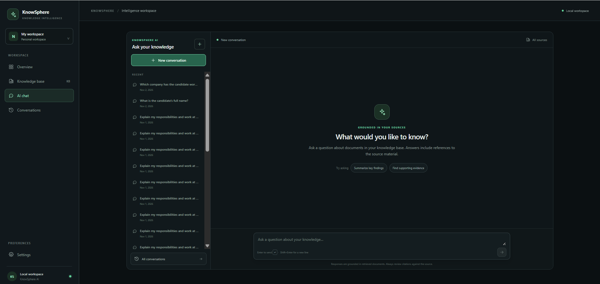
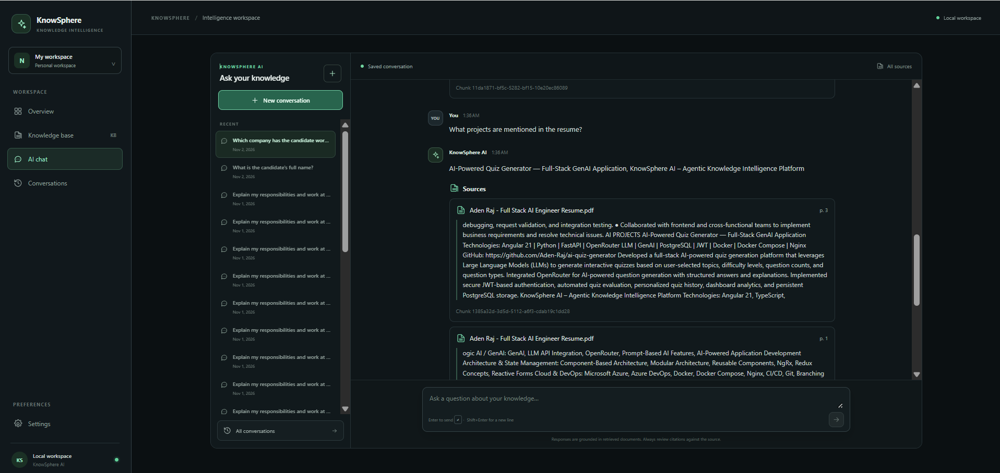
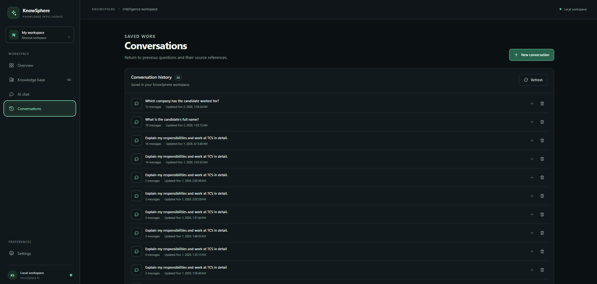
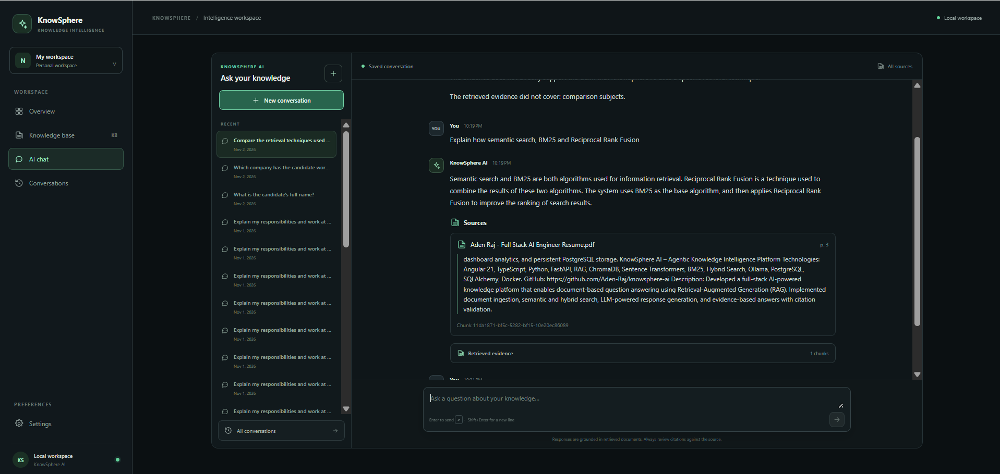
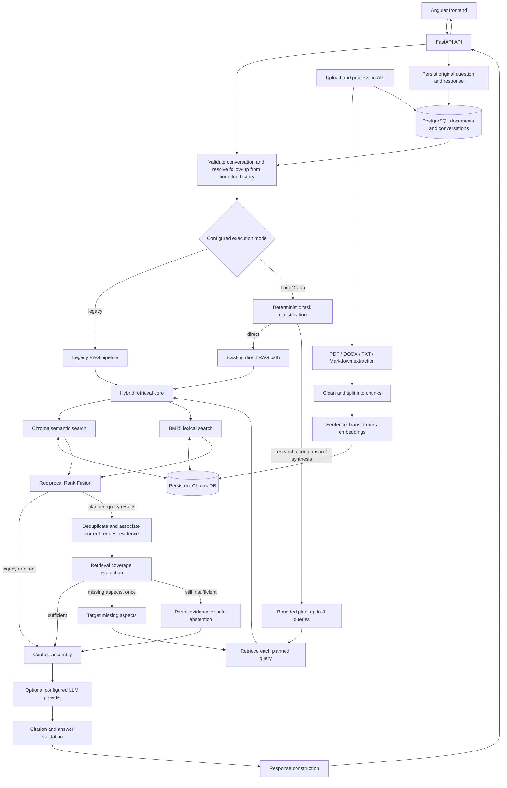

# KnowSphere AI

**KnowSphere AI – Agentic Knowledge Intelligence Platform**

_Transform documents into intelligence._

KnowSphere AI is an AI-powered knowledge platform for ingesting and organizing documents, searching their content, and answering questions with retrieved evidence and source citations. It combines document processing, hybrid Retrieval-Augmented Generation (RAG), bounded LangGraph workflows, and deterministic conversational follow-up resolution.

## Problem and approach

Enterprise knowledge is often spread across long, unstructured documents. Finding a precise answer can require repeated manual searches and makes it difficult to verify where an answer came from. KnowSphere AI provides a document workspace and retrieves source passages for answers, keeping citations visible so users can inspect the underlying evidence.

## Navigation

- [Implemented capabilities](#what-is-implemented)
- [Architecture](#architecture)
- [Request paths](#request-paths)
- [API](#api)
- [Local development](#local-development)
- [Demo guide](DEMO.md)
- [Application screenshots](#application-screenshots)
- [Limitations](#security-and-known-limitations)

## What is implemented

- Upload and process PDF, DOCX, TXT, and Markdown files. Extraction supports text-based documents; OCR for scanned pages is not implemented.
- Track document status and metadata in PostgreSQL. Extracted chunks are embedded locally with Sentence Transformers and stored in persistent ChromaDB.
- Search with semantic retrieval and BM25 lexical retrieval, combined using Reciprocal Rank Fusion (RRF). Retrieval supports document filters, relevance thresholds, and bounded context selection.
- Ask questions using an optional Ollama or OpenAI-compatible provider. Answers include citations to retrieved chunks; when generation is unavailable or evidence is insufficient, the API returns the corresponding safe status/evidence response.
- Save conversations and messages in PostgreSQL. A bounded history loader and deterministic resolver can clarify clear follow-up references. History is used only to resolve the query; prior answers are not evidence.
- Choose the legacy RAG execution path or the LangGraph path through `RAG_EXECUTION_MODE`. LangGraph classifies tasks as direct, research, comparison, or synthesis. Direct questions retain the lightweight existing RAG flow. Complex tasks use deterministic query decomposition (up to three initial retrieval queries), aggregate current-request evidence, evaluate retrieval coverage, and allow at most one targeted adjustment round of up to three queries before generation or safe partial handling.
- Manage documents, chat, saved conversations, and settings through the Angular application.

Coverage evaluation is a retrieval-coverage heuristic. It is not a general semantic fact verifier and does not guarantee factual correctness. Existing citation and claim safeguards validate supported categories of output, but cannot prove every possible natural-language claim.

## Application Screenshots



*Workspace Dashboard*



*Knowledge Base and Document Ingestion*



*AI Chat – Empty State*



*AI-Generated Answer with Source Citations*



*Conversation History*



*Hybrid Retrieval Demonstration*

## Architecture



The diagram shows two execution modes: the legacy path and LangGraph. Only explicitly complex tasks enter planning, evidence aggregation, and coverage evaluation; direct tasks bypass those stages. Conversation history only helps resolve references before retrieval. The retrieval context and citations for each response come from document chunks retrieved for that request.

### Technology stack

| Area                   | Technology                             | Role                                                                |
| ---------------------- | -------------------------------------- | ------------------------------------------------------------------- |
| Web client             | Angular 21, TypeScript, RxJS           | Dashboard, knowledge base, chat, conversation history, and settings |
| API                    | Python, FastAPI, Pydantic              | HTTP endpoints and request/response validation                      |
| Relational persistence | PostgreSQL, SQLAlchemy 2, Alembic      | Document metadata, processing status, conversations, and messages   |
| Vector retrieval       | ChromaDB                               | Persistent embeddings and chunk metadata                            |
| Lexical retrieval      | BM25 implementation in the backend     | Keyword candidate ranking, fused with semantic retrieval using RRF  |
| Embeddings             | Sentence Transformers                  | Local document/query embeddings; CPU is the default device          |
| Workflow orchestration | LangGraph                              | Optional bounded RAG workflow selected by configuration             |
| LLM providers          | Ollama or OpenAI-compatible HTTP API   | Optional grounded answer generation                                 |
| File extraction        | PyMuPDF, python-docx                   | PDF and DOCX text extraction                                        |
| Local service          | Docker Compose                         | PostgreSQL for development                                          |
| Tests                  | Pytest and Node's built-in test runner | Backend and frontend regression checks                              |

LlamaIndex is not currently a project dependency. The application does not implement independent LLM agents, a general-purpose agent tool system, or LangGraph checkpoint persistence.

## Request paths

### Direct RAG

Simple questions use the existing retrieval path: query analysis, hybrid retrieval, RRF ranking, context selection, optional single-provider generation, response validation, and result construction. The LangGraph direct route bypasses task planning and evidence-coverage adjustment. Legacy mode remains available and is the default.

### Research, comparison, and synthesis

In LangGraph mode, explicit complex intent is classified deterministically. A bounded planner creates up to three focused retrieval queries; comparison queries retain subject association. Results are deduplicated by chunk ID and selected under one context budget. A deterministic coverage check can trigger one targeted adjustment round for missing aspects. The system then uses the existing generation, citation, and response-validation services. It does not make a planning or verification LLM call, and it makes at most one final generation call.

### Evidence and limitations

Retrieved files are untrusted input. Prompts instruct the provider to ignore instructions embedded in documents and answer from retrieved evidence. Citation IDs are checked against chunks selected for the current request. Domain-specific checks cover cases such as polar technology questions and duration attribution; these are safeguards, not universal entailment verification. Provider configuration is optional, so retrieval can still return evidence without generated answers.

## API

FastAPI publishes interactive documentation while running:

- Swagger UI: [http://localhost:8000/docs](http://localhost:8000/docs)
- ReDoc: [http://localhost:8000/redoc](http://localhost:8000/redoc)
- OpenAPI JSON: [http://localhost:8000/openapi.json](http://localhost:8000/openapi.json)

Implemented endpoints include:

- `GET /api/v1/health` and `GET /api/v1/ready`
- `POST /api/v1/documents/upload` and `POST /api/v1/documents/upload/multiple`
- `GET /api/v1/documents`, `GET /api/v1/documents/{document_id}`, `DELETE /api/v1/documents/{document_id}`, and `POST /api/v1/documents/{document_id}/reindex`
- `POST /api/v1/chat/query` and `POST /api/v1/chat/retrieve`
- `GET /api/v1/chat/conversations`, `GET /api/v1/chat/conversations/{conversation_id}`, and `DELETE /api/v1/chat/conversations/{conversation_id}`

The query response contains the answer (when available), citations, retrieved chunks, provider/model metadata, generation status, retrieval metadata, and conversation ID. See the OpenAPI schema for exact field definitions.

## Local development

### Configure environment

From the repository root in PowerShell, create local environment files only if absent:

```powershell
if (-not (Test-Path .env)) { Copy-Item .env.example .env }
if (-not (Test-Path backend/.env)) { Copy-Item backend/.env.example backend/.env }
```

Set the same local PostgreSQL database, user, and password in both files. Align root `POSTGRES_PORT` with the port in `backend/.env`'s `DATABASE_URL`; URL-encode special characters in the URL password. Never commit `.env` files.

On the documented Windows development machine, port 5432 is used by a local PostgreSQL service and port 5433 by another container. The ignored local environment files map this project to **15432**. Keep `POSTGRES_PORT=15432` and the backend `DATABASE_URL` port aligned. The example files use 5432 for other environments.

### Start PostgreSQL

Docker Compose starts PostgreSQL only; the API and Angular development server run locally.

```powershell
docker compose up -d postgres
docker compose ps
docker compose logs --tail=50 postgres
```

### Install and run the backend

From the repository root:

```powershell
if (-not (Test-Path backend/.venv)) { python -m venv backend/.venv }
Set-Location backend
.\.venv\Scripts\python.exe -m pip install -e ".[dev]"
.\.venv\Scripts\python.exe -m alembic upgrade head
.\.venv\Scripts\python.exe -m uvicorn app.main:app --reload
```

The API listens at `http://localhost:8000`. Check `/api/v1/health` for liveness and `/api/v1/ready` for database readiness. Upload processing uses FastAPI background tasks in the current process; it is not a durable distributed queue.

RAG runs in legacy mode by default. To select LangGraph, set `RAG_EXECUTION_MODE=langgraph` in `backend/.env` and restart the API. Supported values are `legacy` and `langgraph`.

To enable local Ollama generation, configure `LLM_PROVIDER=ollama`, `LLM_MODEL`, and `OLLAMA_BASE_URL` in `backend/.env`. The application does not install Ollama or download models. For an OpenAI-compatible endpoint, configure its provider, model, base URL, and secret key using the matching variables in `backend/.env.example`. Do not put API credentials in frontend configuration.

### Run backend tests

From `backend/`:

```powershell
.\.venv\Scripts\python.exe -m pytest
```

### Run the frontend

In a separate PowerShell terminal:

```powershell
Set-Location frontend
npm.cmd install
npm.cmd start
```

The Angular development server runs at `http://localhost:4200`; its API base URL is in `src/environments/environment.ts`. Run the current Node-based frontend checks from `frontend/` with `node --experimental-strip-types --test "src/**/*.spec.ts"`, and run `npm.cmd run build` for the production build. The Angular CLI test target is not configured yet, so `npm.cmd test` cannot currently discover a test target. `npm.cmd` works where PowerShell's execution policy blocks the `npm.ps1` shim.

## Project structure

```text
backend/
  app/api/                 FastAPI routers and endpoints
  app/core/                Settings and shared configuration
  app/db/                  SQLAlchemy base, engine, and session dependency
  app/models/              Document and conversation models
  app/services/            Ingestion, storage, conversation memory, and RAG services
  app/services/rag/        Retrieval pipeline, providers, graph, and graph state
  migrations/              Alembic environment and schema revisions
  tests/                   Backend unit and API tests
  pyproject.toml           Python package and dependency configuration
frontend/
  src/app/                 Angular standalone application and pages
  src/environments/        API base URL configuration
docker-compose.yml         Local PostgreSQL service
.env.example               Root Docker Compose environment template
README.md                  Product, architecture, and development guide
DEMO.md                    Suggested manual demo walkthrough
```

## Security and known limitations

- Authentication, user ownership, and document-level authorization are not implemented. Conversation IDs are not user-scoped; do not expose this deployment as a multi-user service without adding access control.
- Scanned-document OCR, durable background job processing, and persistent graph checkpoints are not implemented.
- Coverage evaluation measures retrieval association/coverage, not semantic entailment. Citations and answer checks reduce risk but cannot guarantee factual correctness.
- Local uploads, ChromaDB files, model caches, and credentials belong in ignored runtime/environment files, not source control.
