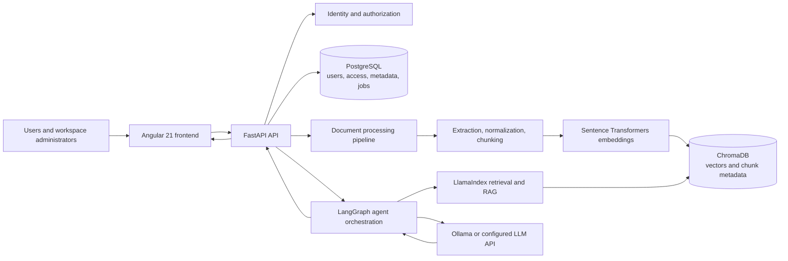

# KnowSphere AI

**KnowSphere AI – Agentic Knowledge Intelligence Platform**

*Transform documents into intelligence.*

KnowSphere AI is an AI-powered enterprise knowledge intelligence platform that enables users to ingest, organize, search, understand, and analyze information using Retrieval-Augmented Generation (RAG) and Agentic AI.

The platform combines document intelligence, semantic search, contextual question answering, multi-document analysis, and autonomous AI workflows to transform unstructured information into actionable insights.

## Platform architecture

KnowSphere AI separates the user experience, API and orchestration services, relational records, and vector retrieval so each layer can evolve independently.



### Technology stack

| Area | Technology | Role |
| --- | --- | --- |
| Web client | Angular 21, TypeScript, RxJS | Workspace, document management, search, and analysis experiences |
| API | Python, FastAPI, Pydantic | REST endpoints, request validation, authentication boundaries, and service coordination |
| Relational data | PostgreSQL, SQLAlchemy, Alembic | Users, workspaces, permissions, document metadata, processing state, and audit records |
| Vector retrieval | ChromaDB | Embedding and metadata index for knowledge chunks |
| RAG framework | LlamaIndex | Document indexing and retrieval building blocks |
| Agent orchestration | LangGraph | Stateful, tool-using AI workflows |
| Embeddings | Sentence Transformers | Local or configurable text embedding models |
| Language models | Ollama or a configurable LLM API | Answer generation and analysis |
| Packaging | Docker, Docker Compose | Repeatable local services and deployment packaging |
| Quality | Pytest | Backend and service-level automated tests |

Model names, provider endpoints, and credentials are configuration, not source code. Remote model providers may incur charges; local Ollama can be used where supported.

## Product capabilities

The product is designed to support these workflows. The current repository implements the platform foundation listed in [Current implementation](#current-implementation); the document, RAG, agent, and security workflows below describe intended capabilities and are not yet available as application features.

### Document ingestion and processing

Users will be able to add documents through the workspace, with the service validating file type and size, extracting text and structure, normalizing content, splitting it into traceable chunks, and recording processing state and errors. Each chunk will retain source metadata such as document identity and page or section location so retrieved information can be cited.

Processing will be designed for retries and duplicate detection. PostgreSQL will store document records and lifecycle metadata; ChromaDB will hold vector representations and retrieval metadata. The binary file storage provider and supported formats will be configured as the ingestion implementation is built.

### Semantic search and citation-based RAG

Search will embed a user query, retrieve relevant chunks from ChromaDB, apply workspace and document access filters, and assemble context for the configured language model. Answers will include source references tied to the retrieved chunks so users can inspect the supporting document, page, or section. If the available context does not support an answer, the service should say so rather than invent a source.

### LangGraph agents and AI tools

LangGraph will coordinate multi-step workflows such as comparing documents, summarizing a collection, extracting structured facts, and answering questions that require multiple retrieval steps. Agent tools will be explicit, typed, and permission-scoped; document search and analysis will operate only on content the requesting user can access. Tool activity and final source references will be available for review.

### Authentication, authorization, and security

The target platform will support authenticated users and workspace membership with role- and resource-based access checks. Authorization will be enforced by the API for document access, search filters, and agent tools, not only by the frontend. The identity provider and token strategy remain configurable implementation choices.

Security controls will include secret-free source control, environment-based credentials, input and upload validation, least-privilege database access, protected operational endpoints, and auditable access and processing events. Production deployments should use TLS and managed encryption for data at rest and backups.

### Evaluation, testing, and observability

Pytest is used for backend tests. The current tests cover health and readiness behavior. As retrieval and generation capabilities are implemented, evaluation will include representative question sets, retrieval relevance, citation correctness, answer grounding, and regression checks across model or prompt changes.

Operational observability is intended to cover structured application logs, request and processing status, latency and error metrics, model usage, and traceable agent/tool steps. Sensitive document content and credentials must not be written to logs by default.

## Current implementation

The repository currently contains a working foundation:

- Angular 21 standalone application with a workspace overview and a live API health indicator.
- FastAPI application with `GET /api/v1/health` and database-backed `GET /api/v1/ready` endpoints.
- SQLAlchemy `KnowledgeDocument` model and an Alembic migration for its initial PostgreSQL schema.
- Docker Compose PostgreSQL service and environment-based configuration.
- Pytest coverage for API liveness and database readiness.

Document upload, content processing, search, RAG answers, authentication, authorization, agent workflows, and production observability are not implemented yet. The frontend does not currently expose those workflows.

## Data architecture

PostgreSQL is the source of truth for structured application data: workspace membership, access policy, document identity and metadata, processing status, and audit events. Alembic migrations manage schema changes.

ChromaDB is intended for vector search over document chunks. Each vector record will carry identifiers and filterable metadata that map back to its PostgreSQL document record. PostgreSQL and ChromaDB have different responsibilities: relational data governs identity and access, while the vector index helps locate relevant content. Search results must be checked against the current authorization rules before they are provided to a user or an agent.

## API documentation

When the FastAPI server is running, interactive OpenAPI documentation is available at:

- Swagger UI: [http://localhost:8000/docs](http://localhost:8000/docs)
- ReDoc: [http://localhost:8000/redoc](http://localhost:8000/redoc)
- OpenAPI schema: [http://localhost:8000/openapi.json](http://localhost:8000/openapi.json)

The implemented API currently exposes only the health and readiness endpoints described above.

## Local development

### Configure environment

From the repository root in PowerShell, create local environment files from the examples if they do not already exist:

```powershell
if (-not (Test-Path .env)) { Copy-Item .env.example .env }
if (-not (Test-Path backend/.env)) { Copy-Item backend/.env.example backend/.env }
```

Set the same local PostgreSQL password in both files. Keep `POSTGRES_DB`, `POSTGRES_USER`, and the password in `DATABASE_URL` aligned. URL-encode special characters in the password when placing it in `DATABASE_URL`. Never commit `.env` files.

On the current Windows machine, a local PostgreSQL service uses port 5432 and another container uses port 5433. The ignored local environment files use port **15432** for this project. Set `POSTGRES_PORT=15432` in the root `.env` and use port `15432` in `backend/.env`'s `DATABASE_URL`. On another machine, choose an available port and keep both settings aligned; the example files use the standard port 5432.

### Start PostgreSQL

From the repository root:

```powershell
docker compose up -d postgres
docker compose ps
docker compose logs --tail=50 postgres
```

Wait for the PostgreSQL container to report healthy before running migrations.

### Install and run the backend

From the repository root, create a virtual environment only if one is not already present, then install the project and development dependencies:

```powershell
if (-not (Test-Path backend/.venv)) { python -m venv backend/.venv }
Set-Location backend
.\.venv\Scripts\python.exe -m pip install -e ".[dev]"
.\.venv\Scripts\python.exe -m alembic upgrade head
.\.venv\Scripts\python.exe -m uvicorn app.main:app --reload
```

The API listens at `http://localhost:8000`. Verify liveness at `/api/v1/health` and database readiness at `/api/v1/ready`.

### Run backend tests

From the `backend/` directory:

```powershell
.\.venv\Scripts\python.exe -m pytest
```

### Install and run the frontend

In a separate terminal, from the repository root:

```powershell
Set-Location frontend
npm.cmd install
npm.cmd start
```

The Angular development server runs at `http://localhost:4200`. `npm.cmd` works in PowerShell environments where execution policy blocks the `npm.ps1` shim. The frontend API base URL is configured in `frontend/src/environments/environment.ts`.

To verify the production build, run `npm.cmd run build` from `frontend/`.

## Project structure

```text
backend/
  app/
    api/                 FastAPI routers and routes
    core/                Settings and shared application configuration
    db/                  SQLAlchemy base, engine, and session dependency
    models/              Relational data models
  migrations/            Alembic environment and schema revisions
  tests/                 Backend tests
  pyproject.toml         Python package and dependency configuration
frontend/
  src/
    app/                 Angular application and workspace UI
    environments/        Frontend environment configuration
  angular.json           Angular build and serve configuration
docker-compose.yml       Local PostgreSQL service
.env.example             Local Docker Compose environment template
README.md                Product, architecture, and development guide
```
